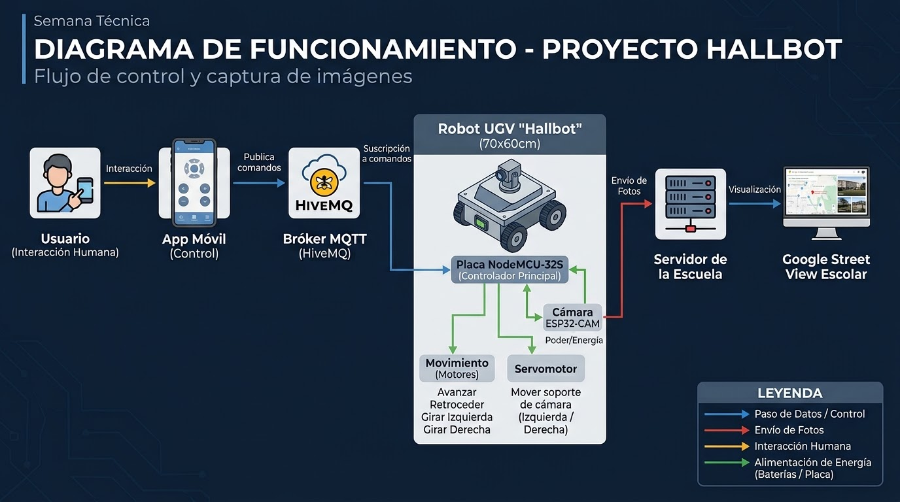

# HallBot: Sistema Robótico de Mapeo Virtual Escolar

HallBot es un vehículo robótico estilo Google Street View controlado a distancia desde una aplicación de celular. Está desarrollado con microcontroladores ESP32 y utiliza comunicación inalámbrica mediante el protocolo MQTT. Su objetivo principal es facilitar la adaptación e integración de los alumnos ingresantes, permitiéndoles explorar de forma virtual e interactiva las aulas, pasillos, laboratorios y espacios comunes de la institución antes o durante sus primeros días de clase.

## Contenido

- Funcionamiento general
- Impacto institucional
- Estado actual del proyecto
- Guía de deploy y traspaso de la app móvil (secciones 1 a 14)

---

## Funcionamiento general

El sistema integra movilidad terrestre, captura fotográfica panorámica y almacenamiento automatizado en un servidor:

1. **Control remoto desde el celular.** El robot se conecta a la red Wi-Fi del colegio y se suscribe a un tópico MQTT (`robot/movimiento/...`) a través de un bróker. Desde una aplicación móvil se envían los comandos de desplazamiento (`adelante`, `atras`, `giro_izq`, `giro_der`, `stop`) y de orientación de cámara (`camara_der`, `camara_izq`).
2. **Captura panorámica (360°).** En puntos estratégicos del recorrido, se detiene el vehículo desde la app y se rota el módulo de cámara mediante un motor paso a paso en incrementos de 90° (cuartos de vuelta) para fotografiar todo el entorno.
3. **Almacenamiento automatizado.** La cámara (una ESP32-CAM, que es un controlador independiente del que mueve el robot) recibe la orden `foto` por MQTT, saca la imagen y la sube por HTTP a un servidor del colegio. Ahí las fotos se guardan con nombre único y se pueden ver desde una galería web.

## Impacto institucional

- **Orientación para ingresantes:** reduce la desorientación en los primeros días de clase al ofrecer una referencia visual real de la distribución del edificio.
- **Escalabilidad:** la arquitectura basada en MQTT y servicios en la nube o en un servidor propio permite actualizar fácilmente el mapa ante cambios edilicios o integrar sensores adicionales (como ultrasonido para detectar obstáculos) en futuras etapas.

## Estado actual del proyecto

Este repositorio contiene **solamente la app móvil**. El resto del sistema vive en otros códigos que hay que buscar por separado.

Qué hay hecho:

- **App móvil (este repo):** login con bloqueo por intentos, conexión al bróker con verificación, cruceta de movimiento y botones de giro de cámara.
- **Firmware del robot:** recibe los comandos por MQTT y mueve los motores y el motor paso a paso de la cámara (fuera de este repo).
- **Firmware de la ESP32-CAM:** escucha `foto` en `hallbot/camera/cmd`, captura, sube la imagen por HTTP y responde el estado en `hallbot/camera/status` (fuera de este repo).
- **Servidor de fotos:** servicio Flask en una máquina virtual del colegio que recibe los JPG en `/upload` (autenticado con un token) y los muestra en `/fotos` (fuera de este repo).

Qué falta:

- **Botón de foto en la app** y lectura del estado que informa la cámara (`uploaded:...` o `error:...`). Los pasos están en la sección 12.
- **Ver la galería desde la app** (hoy se abre en el navegador, escribiendo la dirección del servidor).
- **Sensor ultrasónico** para detectar obstáculos (etapa futura).
- **Endurecer la seguridad** del bróker y del login antes de usar el robot fuera de pruebas (sección 10).

---

## Guía de deploy y traspaso de la app móvil

Esta guía explica cómo instalar, configurar, ejecutar y distribuir la app de control de HallBot, y qué cosas hay que saber antes de tocar el código. Está pensada para quien herede el proyecto, así que además de los pasos incluye el porqué de cada decisión y las trampas conocidas.

Las versiones y los comportamientos descriptos se verificaron leyendo el repositorio (`package.json`, `package-lock.json`, `app.json`, `src/`). Cuando algo no se pudo comprobar, se aclara.

---

### 1. Arquitectura del sistema y rol de la app

HallBot es un UGV (vehículo terrestre no tripulado) que recorre el colegio sacando fotos. Esta app es el **control remoto**: un celular Android desde el que se pilota el robot y se mueve el motor de la cámara.

La app **no habla directo con el robot**. Solo publica mensajes MQTT en un broker, y el robot (otro microcontrolador) los lee de ahí. El sistema completo tiene cuatro piezas:



Qué vive en este repositorio y qué no:

- **En este repo:** solo la app móvil (login, conexión al broker, botones de movimiento y de giro de cámara).
- **Fuera de este repo:** el firmware del controlador del robot, el firmware de la ESP32-CAM y el servidor de fotos de la VM. Si vas a mejorar alguna de esas partes, buscá su código por separado.

---

### 2. Stack y versiones

Estas son las versiones exactas que declara `package.json` y que quedaron fijadas en `package-lock.json`:

- Expo SDK: `expo ~58.0.22`
- React Native: `0.88.1`
- React: `19.3.0`
- Cliente MQTT: `paho-mqtt ^1.1.0` (JavaScript puro, sin código nativo)
- `expo-status-bar ~58.0.4`
- Gestor de paquetes: **npm** (el lockfile es de npm, versión 3)
- Lenguaje: JavaScript (no hay TypeScript en el proyecto)

Dos detalles que importan:

- Como `paho-mqtt` es JavaScript puro, la app **corre dentro de Expo Go** sin necesidad de compilar código nativo. Es lo más rápido para desarrollar y probar.
- Si en algún momento agregás una librería con código nativo, Expo Go ya no alcanza y vas a necesitar un *development build* (ver sección 9).

---

### 3. Requisitos previos

Para desarrollar y probar con Expo Go:

1. **Node.js 22.13 o superior** (también sirven 24.3+ y 26+). Es un requisito declarado por las dependencias: con un Node más viejo la instalación o el arranque van a fallar. Se verificó el proyecto con Node 22.23.
2. **npm** (viene con Node).
3. **Git**.
4. Un **celular Android** con la app **Expo Go** instalada. Tiene que ser una versión de Expo Go compatible con el SDK 58 (la tienda suele ofrecer la última; si al escanear el QR te avisa de incompatibilidad, actualizá Expo Go).

Para generar un APK instalable (sección 8) además necesitás una cuenta gratuita en expo.dev.

Instalar Node con `nvm` (Linux y macOS):

```bash
curl -o- https://raw.githubusercontent.com/nvm-sh/nvm/master/install.sh | bash
# cerrá y volvé a abrir la terminal
nvm install 22
node -v   # tiene que mostrar v22.x o superior
```

---

### 4. Instalación y primera ejecución

```bash
git clone https://github.com/00luchoc/hallbot-app.git
cd hallbot-app
npm ci
```

Se usa `npm ci` (en vez de `npm install`) porque instala exactamente lo que dice `package-lock.json`, así todos tienen las mismas versiones. Si necesitás agregar una dependencia, mirá la sección 11.

Antes de arrancar **tenés que crear el archivo `.env`** (sección 5). Si no lo creás, la app abre pero se rompe al intentar iniciar sesión.

Cuando tengas el `.env`:

```bash
npx expo start
```

Esto levanta el servidor de desarrollo (Metro) y muestra un código QR en la terminal. En el celular, abrí Expo Go y escaneá el QR.

#### Si el celular no encuentra el servidor

El celular y la PC tienen que estar en la misma red. Muchas redes (la del colegio incluida) aíslan a los dispositivos entre sí y el QR no funciona. Soluciones, de la más simple a la menos:

1. Conectar PC y celular a **la misma red doméstica o al hotspot del celular**.
2. Usar el túnel de Expo: `npx expo start --tunnel` (pide instalar una dependencia la primera vez y es más lento).

---

### 5. Variables de entorno (`.env`)

El login de la app lee cuatro variables. En el repo hay una plantilla: `.env.example`. El archivo real, `.env`, está en `.gitignore` y **nunca se debe subir a git**.

Pasos:

```bash
cp .env.example .env
```

Abrí `.env` y editalo así (con tus valores reales):

```
EXPO_PUBLIC_ADMIN_USER=usuario_admin
EXPO_PUBLIC_ADMIN_PASS=clave_admin

EXPO_PUBLIC_OP_USER=usuario_operador
EXPO_PUBLIC_OP_PASS=clave_operador
```

Cosas a tener en cuenta:

- **Borrá la primera línea de la plantilla** (la que empieza con `/ Datos necesarios...`). En archivos `.env` los comentarios van con `#`, y esa línea con `/` no es un comentario válido. Si la dejás puede generar una advertencia o ser ignorada según la herramienta.
- **No dejes ninguna de las cuatro variables sin definir.** El código recorre los dos operadores y llama `.toLowerCase()` sobre el usuario de cada uno. Si una variable falta, es `undefined` y la app **se cierra con un error** apenas alguien aprieta "INICIAR SESIÓN".
- **Las variables se leen al armar el bundle**, no en tiempo de ejecución. Si cambiás el `.env` con el servidor corriendo, hay que reiniciarlo limpiando la caché:

```bash
npx expo start --clear
```

- El nombre del usuario se compara sin distinguir mayúsculas; la contraseña sí distingue.
- Los nombres visibles de cada rol (`LUCIANO · ADMIN · PILOTO` y `OPERADOR ETEC · TÉCNICO`) están escritos fijos en `src/constants/authConfig.js`. Si cambia el equipo, se editan ahí.
- El bloqueo por intentos fallidos también está en ese archivo: 3 intentos y 15 segundos de espera (`SECURITY_CONFIG`).

#### Advertencia importante sobre este login

Todas las variables que empiezan con `EXPO_PUBLIC_` **se incrustan en el código JavaScript de la app**. Cualquiera que tenga el APK o el bundle puede extraer los usuarios y contraseñas. Este login es una barrera de uso para evitar toques accidentales, **no es seguridad real**. Ver la sección 10.

---

### 6. Configuración MQTT: el contrato con el robot

Todo lo relacionado con MQTT está en dos archivos:

- `src/constants/mqttConfig.js`: broker por defecto, topics y comandos.
- `src/hooks/useMqttClient.js`: la lógica de conexión y publicación.

#### Broker por defecto

```js
export const DEFAULT_BROKER_URL = 'wss://mqtt-dashboard.com:8884/mqtt';
```

Es el broker público de HiveMQ por **WebSocket seguro**. El formato de la URL tiene que ser `wss://host:puerto/ruta` o `ws://host:puerto/ruta`. El puerto es **obligatorio**: el código valida la URL con una expresión regular y, sin puerto, muestra "URL inválida". La URL se puede cambiar desde la propia app (tarjeta "BROKER") sin recompilar.

Ojo: la app usa **WebSocket**, no el puerto MQTT clásico (1883) que usa la ESP32. Son dos "puertas" distintas del mismo broker y se hablan entre sí sin problema.

#### Topics

```js
export const APP_ID = 'etec-uba-hallbot-cambiame123';

export const TOPICS = {
  movement: 'robot/movimiento/lucho2024abc',
  ping: `${APP_ID}/ping`,
};
```

- `movement`: el topic al que se publican todas las órdenes de manejo y de giro de cámara. **El firmware del robot tiene que estar suscrito exactamente a este mismo string.**
- `ping`: se usa solo para verificar la conexión (ver más abajo).
- `APP_ID` conviene cambiarlo por algo propio y largo, porque el broker es público y cualquiera podría escribir en tu topic de ping.

#### Comandos

El mensaje es un texto plano. El robot tiene que reconocer estos valores exactos:

- `adelante`, `atras`, `giro_izq`, `giro_der`: movimiento.
- `stop`: detiene el robot.
- `camara_izq`, `camara_der`: giro horizontal del motor de la cámara.

Comportamiento de los botones (`MovementPad.js` y `CameraControls.js`):

- Los botones de movimiento mandan la orden al **apretar** (`onPressIn`) y mandan `stop` al **soltar** (`onPressOut`). Es un control de "hombre muerto": si soltás, el robot frena.
- El botón central `■` manda `stop` al apretar.
- Los botones de cámara mandan la orden **solo al apretar**, no mandan nada al soltar. Es decir que cada toque equivale a un movimiento discreto: el firmware gira el motor paso a paso un cuarto de vuelta (90°) por mensaje, y la app no controla cuánto gira.
- Los mensajes se publican con la calidad por defecto de Paho (QoS 0, sin retain). Si un mensaje se pierde, no se reintenta.

#### Cómo verifica la app que la conexión funciona

El indicador de estado pasa por estas etapas:

1. `DESCONECTADO`.
2. `CONECTANDO…` al apretar CONECTAR.
3. `CONECTADO · VERIFICANDO…` cuando el broker aceptó la conexión.
4. `VERIFICADO ✓` cuando la app **se envía un mensaje a sí misma** por el topic de ping y le vuelve. Eso prueba que el camino completo de publicar y recibir funciona.

Si a los 5 segundos no vuelve el ping, queda en el paso 3 con el aviso "Conectó, pero no volvió el mensaje de prueba". Los botones de control están bloqueados (opacidad baja y sin respuesta al toque) mientras no haya conexión.

#### Cómo probar sin el robot

1. Abrí el cliente web de HiveMQ (hivemq.com/demos/websocket-client) y conectate.
2. Suscribite al topic `robot/movimiento/lucho2024abc` (o el que hayas puesto).
3. Desde la app, conectá y apretá botones: tienen que aparecer los mensajes `adelante`, `stop`, etc. en el cliente web.

---

### 7. Checklist de verificación después del deploy

Recorrelo en orden y, si algo falla, andá a la sección 12.

1. `node -v` muestra 22.13 o superior.
2. `npm ci` termina sin errores.
3. Existe `.env` con las cuatro variables definidas y sin la línea `/ Datos...`.
4. `npx expo start` muestra el QR y Expo Go abre la app.
5. La pantalla de login aparece. Entrás con las credenciales del `.env` y ves la animación de bienvenida de unos 2 segundos.
6. En la pantalla de control, apretás CONECTAR y el estado llega a `VERIFICADO ✓`.
7. Con el cliente web de HiveMQ suscripto al topic de movimiento, cada botón genera el mensaje esperado.
8. Con el robot encendido y conectado al mismo broker, responde a los comandos.
9. Probás el bloqueo: tres contraseñas incorrectas seguidas bloquean el login 15 segundos.

---

### 8. Generar un APK instalable (sin Expo Go)

Expo Go sirve para desarrollar, pero para entregar la app a otras personas conviene un APK. La forma recomendada es **EAS Build**, que compila en la nube y no requiere instalar Android Studio.

**Importante:** los comandos y opciones de EAS cambian entre versiones. Antes de ejecutar esto, confirmá contra la documentación vigente (docs.expo.dev, sección EAS Build). Lo que sigue es el flujo general.

#### Paso 1: Resolver los assets que faltan

`app.json` hace referencia a imágenes que **no existen en el repositorio** (no hay carpeta `assets/`):

- `./assets/icon.png`
- `./assets/android-icon-foreground.png`
- `./assets/android-icon-background.png`
- `./assets/android-icon-monochrome.png`
- `./assets/favicon.png`

En Expo Go esto no molesta, pero **al compilar el APK va a fallar o a avisar** que no encuentra esos archivos. Dos opciones:

1. Crear la carpeta `assets/` con esas imágenes (el ícono principal suele ser de 1024x1024 px).
2. Sacar de `app.json` las claves que apuntan a archivos inexistentes y usar los íconos por defecto.

#### Paso 2: Cambiar el identificador de la app

En `app.json` el paquete de Android es `com.anonymous.hallbotapp`, un valor de ejemplo. Antes de distribuir, cambialo por uno propio, por ejemplo `ar.edu.uba.etec.hallbot`. Una vez que publiques en una tienda, ese identificador ya no se puede cambiar.

#### Paso 3: Crear `eas.json`

El repo no trae este archivo. Creá `eas.json` en la raíz con un perfil que genere APK (los `.aab` por defecto no se instalan directo en un celular):

```json
{
  "build": {
    "preview": {
      "distribution": "internal",
      "android": {
        "buildType": "apk"
      }
    }
  }
}
```

#### Paso 4: Cargar las variables de entorno en EAS

El `.env` está en `.gitignore`, así que **EAS no lo recibe**. Si compilás sin cargar las variables, el APK sale con los usuarios y contraseñas vacíos y se cierra al iniciar sesión.

Hay que definir las cuatro variables (`EXPO_PUBLIC_ADMIN_USER`, `EXPO_PUBLIC_ADMIN_PASS`, `EXPO_PUBLIC_OP_USER`, `EXPO_PUBLIC_OP_PASS`) como variables de entorno del proyecto en EAS, desde la consola web de expo.dev o con el comando de variables de EAS CLI. Chequeá en la documentación vigente cómo se declaran para el perfil que uses.

#### Paso 5: Compilar

```bash
npx eas-cli@latest login
npx eas-cli@latest build:configure
npx eas-cli@latest build --platform android --profile preview
```

Cuando termina, EAS entrega un enlace de descarga del APK. Se instala en el celular habilitando "instalar apps de orígenes desconocidos".

#### Alternativa local

Si preferís compilar en tu máquina: `npx expo run:android`. Requiere Android Studio, el SDK de Android y un JDK compatible con React Native 0.88 (verificá la versión de JDK en la documentación de React Native). Este comando **genera las carpetas `android/` e `ios/`**, que están en `.gitignore` a propósito: el proyecto usa generación nativa continua, así que esas carpetas no se editan a mano. Cualquier cambio nativo se configura desde `app.json` y plugins de config.

---

### 9. Desarrollar con módulos nativos (development build)

Cuando agregues una librería que incluya código nativo, Expo Go no la va a cargar. Ahí hace falta un development build:

- Local: `npx expo run:android`.
- En la nube: `eas build --profile development` (requiere agregar ese perfil en `eas.json` con `"developmentClient": true`).

Para ver si una librería es compatible con el SDK actual, instalala siempre así (resuelve la versión correcta):

```bash
npx expo install nombre-del-paquete
```

---

### 10. Seguridad: lo que hay que saber antes de usarla fuera del aula

Estos puntos no son errores de instalación, son limitaciones del diseño actual. Conviene tenerlas presentes antes de que el robot circule con gente alrededor.

1. **El login no es seguridad real.** Las credenciales viajan dentro del bundle (variables `EXPO_PUBLIC_`). Sirve para evitar toques accidentales, no para impedir un acceso malintencionado.
2. **El broker es público y el topic está en el código.** El repositorio es público (se puede clonar sin credenciales), así que el topic de movimiento (`robot/movimiento/...`) es de conocimiento público. Cualquier persona con un cliente MQTT puede publicar `adelante` en ese topic y mover el robot. El broker público tampoco cifra ni autentica al que publica.
3. **Mejora recomendada:** pasar a un broker propio (por ejemplo Mosquitto en la VM del colegio) con usuario y contraseña, y que tanto la app como el firmware se autentiquen. Con Paho, el usuario y la contraseña se agregan en las opciones de `connect` (`userName` y `password`) en `useMqttClient.js`.
4. **Mientras tanto,** usá topics largos y difíciles de adivinar, sacá el sufijo personal del topic y no los publiques en documentación abierta.
5. **No subas a git** el `.env`, tokens del servidor de fotos ni contraseñas del WiFi.
6. El botón de parada (`stop`) y la lógica de "soltar = frenar" dependen de que el mensaje llegue. Con QoS 0 y un broker público saturado, un `stop` puede perderse. Para pruebas con el robot en movimiento, mantené siempre una forma física de cortar la energía.

---

### 11. Estructura del repositorio y cómo extenderlo

```
hallbot-app/
  index.js                  entrada: registra el componente raíz de Expo
  App.js                    controla el flujo: login -> bienvenida -> control
  app.json                  configuración de Expo (nombre, íconos, paquete Android)
  .env.example              plantilla de variables de entorno
  package.json / lock       dependencias fijadas
  src/
    screens/
      LoginScreen.js        pantalla de login con bloqueo por intentos
      ControlScreen.js      pantalla principal de control
    components/
      Header.js             encabezado con estado de conexión
      BrokerCard.js         campo de URL del broker y botones conectar/desconectar
      MovementPad.js        cruceta de movimiento
      CameraControls.js     botones de giro de cámara
      ActionButton.js       botón base (usa onPressIn / onPressOut)
      WelcomeTransition.js  animación de bienvenida (~2 s)
    hooks/
      useMqttClient.js      conexión, verificación por ping y publicación
    constants/
      mqttConfig.js         broker, topics y comandos
      authConfig.js         operadores autorizados y política de bloqueo
      theme.js              colores y textos de estado
```

Cómo está resuelta la navegación: **no usa un enrutador**. `App.js` guarda en estado quién inició sesión y si hay que mostrar la bienvenida, y renderiza una de tres pantallas según ese estado. Es simple y suficiente para tres pantallas; si el proyecto crece, conviene migrar a Expo Router.

Dos recomendaciones de mantenimiento:

- Agregá dependencias siempre con `npx expo install`, nunca con `npm install` a secas, para que respete las versiones del SDK.
- Si actualizás el SDK de Expo, hacelo de a un salto, corré `npx expo-doctor` y probá todo el checklist de la sección 7.

Nota sobre `AGENTS.md`: el repo incluye ese archivo con convenciones pensadas para asistentes de código. Algunas de sus indicaciones (por ejemplo, usar Expo Router con rutas en `src/app/` o correr `tsc`) **no coinciden con el estado actual del proyecto**, que usa JavaScript y navegación por estado. Tomalo como una guía general y verificá contra el código real.

---

### 12. Funcionalidades pendientes conocidas

La app todavía **no maneja la cámara de fotos**: solo gira el motor de la cámara. Esto es lo que falta para cerrar el circuito, usando lo que ya existe en el sistema.

El firmware de la ESP32-CAM (que vive fuera de este repo) escucha y responde por estos topics:

- Orden: publicar el texto `foto` en `hallbot/camera/cmd`.
- Respuesta: la cámara publica en `hallbot/camera/status` el texto `uploaded:<nombre>.jpg` si salió bien, o `error:...` si algo falló.
- Mientras sube una foto, rechaza nuevos pedidos con `error:busy`. Por eso la app debería esperar el `uploaded:` antes de pedir otra.

Pasos sugeridos para implementarlo:

1. **Agregar los topics** en `src/constants/mqttConfig.js`:

```js
export const TOPICS = {
  movement: 'robot/movimiento/lucho2024abc',
  ping: `${APP_ID}/ping`,
  cameraCmd: 'hallbot/camera/cmd',
  cameraStatus: 'hallbot/camera/status',
};
```

2. **Agregar un botón FOTO** en `CameraControls.js`. La función `publish` del hook ya acepta un topic como segundo parámetro, y `CameraControls` recibe esa misma función como `onCommand`:

```jsx
<ActionButton
  label="FOTO"
  onIn={() => onCommand('foto', TOPICS.cameraCmd)}
  red
/>
```

(Hay que importar `TOPICS` en ese archivo.)

3. **Escuchar el estado de la cámara.** Hoy `onMessageArrived` en `useMqttClient.js` solo reacciona al topic de ping. Hay que suscribirse a `cameraStatus` después de conectar y guardar el último mensaje en un estado nuevo para mostrarlo en pantalla.
4. **Ver las fotos.** El servidor de fotos de la VM expone la galería en `http://<IP_DE_LA_VM>:5000/fotos` (la IP se la da el colegio, no la subas al repo). La forma más simple es abrirla en el navegador con `Linking.openURL(...)` desde un botón "VER FOTOS". Mostrar la galería dentro de la app (con `react-native-webview`, instalado con `npx expo install react-native-webview`) también es posible.

Advertencia para la galería: la URL de la VM usa **HTTP sin cifrar**. En los builds de Android modernos el tráfico HTTP sin cifrar está bloqueado por defecto para las peticiones hechas desde la propia app. Abrir la página en el navegador externo evita el problema; si querés cargarla dentro de la app, vas a tener que habilitar tráfico HTTP en la configuración nativa (con el plugin `expo-build-properties`) o poner HTTPS en el servidor.

Otras tareas pendientes detectadas:

- **Modo web:** el script `npm run web` existe, pero faltan las dependencias `react-dom` y `react-native-web`. Para usarlo, ejecutá `npx expo install react-dom react-native-web`. Además, una web servida por HTTPS no puede conectarse a brokers `ws://` sin cifrar; usá siempre `wss://`.
- **Assets:** crear la carpeta `assets/` (sección 8, paso 1).
- **Identificador de Android:** reemplazar el valor de ejemplo (sección 8, paso 2).
- **Mover los topics y el `APP_ID` a variables de entorno** para no tenerlos escritos en un repo público.

---

### 13. Solución de problemas

**La app se cierra al apretar "INICIAR SESIÓN".**
Falta alguna de las cuatro variables del `.env`. Revisá que existan, que no tengan espacios y reiniciá con `npx expo start --clear`.

**"Credenciales inválidas" aunque las ingresás bien.**
Cambiaste el `.env` sin reiniciar el servidor con `--clear`. También verificá que no haya espacios al final de los valores.

**`npm ci` falla o Expo no arranca.**
Revisá la versión de Node (`node -v`): tiene que ser 22.13 o superior. Si el error menciona el lockfile, no lo borres: pedile a quien lo modificó que lo suba completo.

**Expo Go dice que el proyecto es incompatible.**
La versión de Expo Go no soporta el SDK 58. Actualizá la app Expo Go en el celular.

**El QR no conecta o la app queda cargando.**
PC y celular no están en la misma red, o la red aísla clientes. Probá con hotspot o con `npx expo start --tunnel`.

**Estado "ERROR" con "No se pudo conectar".**
- Revisá que la URL tenga el formato `wss://host:puerto/ruta` y con puerto.
- Probá con datos móviles: algunas redes (como las de los colegios) bloquean el puerto 8884 o el tráfico WebSocket.
- Probá el broker desde el cliente web de HiveMQ para descartar que el servicio esté caído.

**Queda en "CONECTADO · VERIFICANDO…" y avisa que no volvió el ping.**
La conexión se abrió pero el broker no devolvió el mensaje de prueba. Puede ser una red que corta el tráfico en un solo sentido o un problema momentáneo del broker. Desconectá y volvé a conectar.

**Los botones no responden.**
Están bloqueados hasta que el estado sea `CONECTADO` o `VERIFICADO`. Revisá el indicador del encabezado.

**La app envía los comandos pero el robot no se mueve.**
Comprobá, en este orden:
1. El cliente web de HiveMQ recibe los mensajes en el topic de movimiento (si no llegan, el problema está en la app o la red del celular).
2. El robot está conectado al mismo broker y suscripto al mismo topic, con exactamente el mismo texto.
3. Los comandos que entiende el firmware son los mismos que envía la app (sección 6).
4. La alimentación del robot y de su WiFi.

**El APK compilado se cierra al abrir sesión.**
Las variables de entorno no estaban cargadas en EAS al compilar (sección 8, paso 4).

**La compilación falla por íconos o imágenes.**
Faltan los archivos de `assets/` que referencia `app.json` (sección 8, paso 1).

---

### 14. Resumen de comandos

```bash
# Instalar
git clone https://github.com/00luchoc/hallbot-app.git
cd hallbot-app
npm ci
cp .env.example .env          # y completar los valores

# Desarrollar
npx expo start                # QR para Expo Go
npx expo start --clear        # limpiar caché (después de cambiar el .env)
npx expo start --tunnel       # si la red aísla dispositivos

# Mantener
npx expo install <paquete>    # agregar dependencias compatibles
npx expo-doctor               # diagnosticar dependencias y configuración
npx expo install --fix        # corregir versiones incompatibles

# Distribuir
npx eas-cli@latest build --platform android --profile preview
npx expo run:android          # alternativa local (requiere Android Studio)
```
